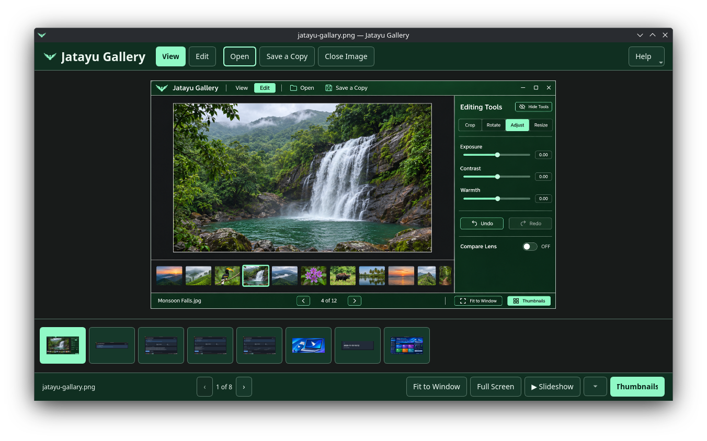

# Jatayu Gallery 0.4.0

A local image viewer and editor designed for JatayuOS and Debian 13. Uses Qt Widgets through PyQt5 and Pillow. The window uses the system title bar so Plasma retains its normal window controls.

## Download

[**Download Jatayu Gallery 0.4.0 for JatayuOS and Debian 13 (.deb)**](https://github.com/jatayuos4u/jatayu-gallery/releases/download/v0.4.0/jatayu-gallery_0.4.0-1_all.deb)

Open a terminal in the download folder and run:

    sudo apt install ./jatayu-gallery_0.4.0-1_all.deb

Launch Jatayu Gallery from the application menu or use your file manager's Open With menu.

## Screenshot

## Use

- Open an image or drop it on the window. Arrow keys and the footer buttons browse supported files in the same folder.
- Select Edit to show the tools. The sidebar and thumbnail strip independently give their space back to the image when hidden.
- Mouse wheel zooms, drag pans a zoomed image, and Fit to Window resets the view. F11 toggles fullscreen.
- Full Screen hides the main controls. Press Esc to exit, or move the mouse to reveal playback controls.
- Slideshow plays images in the current folder. Press Space to play or pause. The menu beside Slideshow changes the interval and enables looping.
- The Help menu opens the offline User Guide with step-by-step instructions, shortcuts, and troubleshooting. It also contains About, License, and Credits.
- Crop by dragging a rectangle, or use rotate, flip, exposure, contrast, warmth and resize. Undo and redo are available during the current image session, subject to history and memory limits.
- Compare Lens shows the original on the left when dimensions match, or displays the complete original when dimensions differ.
- Save a Copy exports PNG, JPEG or WebP. Existing files are protected from overwrite. JPEG transparency is flattened onto white. Export removes source metadata such as GPS tags and retains the ICC profile when available.
- Open supports common JPEG, PNG, WebP, BMP, GIF, TIFF and ICO images up to 32 megapixels. Animated or multi-page files display the first frame or page.

## Build

From this directory run:

    sh build-deb.sh

On Debian 13 with the dependencies installed, run directly with:

    /usr/bin/python3 gallery.py photo.jpg

Use **Close Image** or **Ctrl+W** to return to the empty viewer. Gallery prompts if there are unsaved edits.

## License

Jatayu Gallery source code is licensed under GPL-3.0-only. See [LICENSE](LICENSE).
Python, Qt, PyQt5, and Pillow have their own licenses.

## Releases

Download the installer and matching source archive from [Releases](https://github.com/jatayuos4u/jatayu-gallery/releases). Pre-releases are intended for testing.
